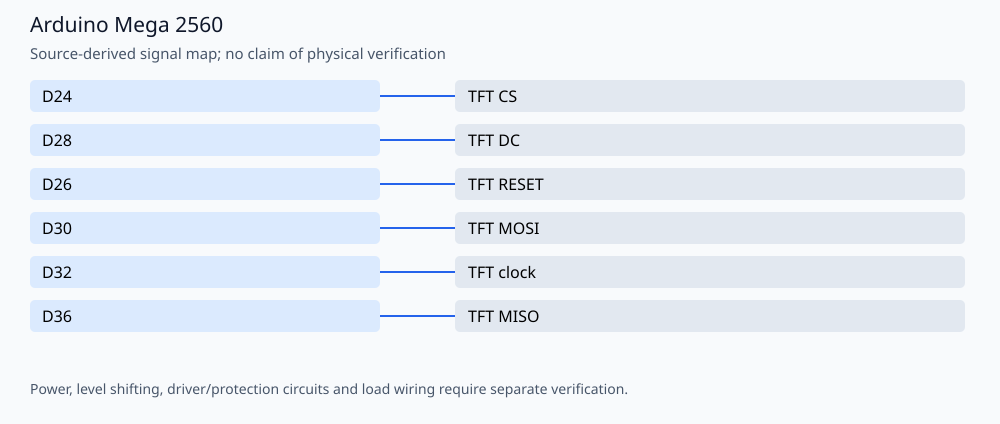

# ILI9341 software SPI demo for Arduino Mega 2560

A small Adafruit ILI9341/GFX display demo that uses software SPI for flexible pin assignments. Author: **Amir Mobasheraghdam**, University of Isfahan.

## Reproducible build

Install Python 3 and **Arduino CLI 1.3.1**, then run from this repository:

```bash
python3 tools/check_firmware.py --install
```

The helper installs `arduino:avr@1.8.6` and `Adafruit BusIO@1.17.0`, `Adafruit GFX Library@1.12.1`, `Adafruit ILI9341@1.6.2`. It compiles these alternatives
separately in temporary folders, without uploading or rewriting the originals:

- `ILI9341_SoftwareSPI_Test.ino`
- `TFT_TEST.ino`

Build target: `arduino:avr:mega`. Once dependencies are installed, omit `--install`
to build offline. `--jobs 2` is the default. Set `ARDUINO_CLI` to a CLI executable
or wrapper when using a custom Arduino configuration. Exact build inputs are in
[`tools/firmware.json`](tools/firmware.json). Library dependencies are listed
explicitly and installed with `--no-deps` so transitive updates cannot silently
replace the pinned versions. These are tested build versions, not a claim that
all other core/library versions are incompatible.

The GitHub Actions workflow repeats the firmware checks on pushes and pull
requests. Compilation validates software/toolchain compatibility; it does not
establish hardware safety or successful physical operation.

## Signal assignments



| Signal | Board pin |
| --- | --- |
| TFT CS | D24 |
| TFT DC | D28 |
| TFT RESET | D26 |
| TFT MOSI | D30 |
| TFT clock | D32 |
| TFT MISO | D36 |

## Operation and validation limits

The signal map applies to **`ILI9341_SoftwareSPI_Test.ino`**. It is not the Mega hardware-SPI pin map. Verify the breakout voltage/logic requirements separately. The legacy `TFT_TEST.ino` is a separate application that drives additional GPIOs, including display-related pins; inspect it before connecting hardware.

Both programs define `setup()` and `loop()`. Opening the repository root as one sketch combines them and causes duplicate definitions. The build helper compiles each in its own folder. To use Arduino IDE, copy just the selected sketch into a matching sketch folder. Existing HEX files are historical artifacts, not proof of the current source build. Serial output uses **9600 baud** for the small demo.

No physical testing, new hardware photographs or measured electrical/optical
performance is claimed. Retain the author attribution and existing license/source
notices when reusing the project.

## License

This project is open source and available under the MIT License.
